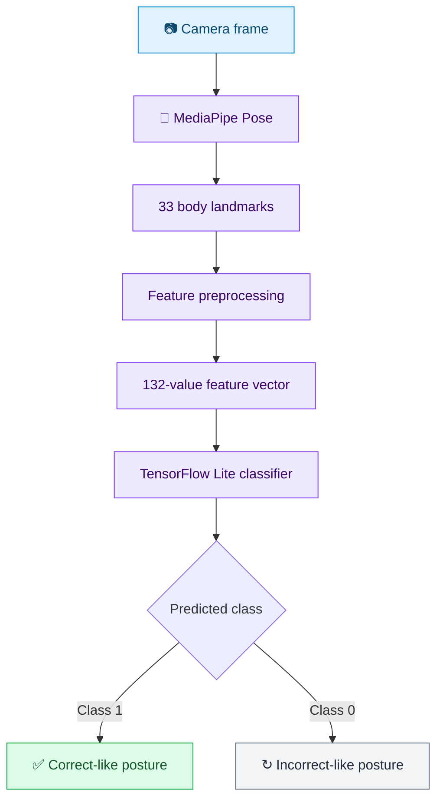

<div align="center">

# 🪑 ErgoVision
### **Posture, with perspective.**

*A student-built AI project exploring real-time sitting-posture awareness using MediaPipe Pose and TensorFlow Lite.*

<!-- Replace the placeholder below once the Render deployment is live. -->

[](#-live-demo)
[](https://developers.google.com/mediapipe)
[](https://www.tensorflow.org/lite)
[](#-academic-project)

---

### 👀 See posture differently

ErgoVision uses pose landmarks and a lightweight machine-learning classifier to estimate whether a sitting posture resembles the **`correct`** or **`incorrect`** examples represented in its dataset.

> **Academic prototype · Computer vision · Human-centred AI**

</div>

---

## 🧭 Table of Contents

- [✨ Project at a Glance](#-project-at-a-glance)
- [🎯 The Problem We Explore](#-the-problem-we-explore)
- [🧠 How the AI Works](#-how-the-ai-works)
- [🧬 Model Details](#-model-details)
- [🗂️ Dataset](#️-dataset)
- [🖥️ The Web App](#️-the-web-app)
- [🚀 Live Demo](#-live-demo)
- [💻 Run Locally](#-run-locally)
- [🔐 Privacy and Responsible Use](#-privacy-and-responsible-use)
- [⚠️ Limitations](#️-limitations)
- [👥 Our Team](#-our-team)
- [🏫 Academic Project](#-academic-project)
- [🙏 Acknowledgements](#-acknowledgements)

---

## ✨ Project at a Glance

<table>
  <tr>
    <td width="50%">
      <h3>🎥 Real-time pose estimation</h3>
      MediaPipe identifies body landmarks from the camera feed so the app can represent a pose numerically.
    </td>
    <td width="50%">
      <h3>⚡ Lightweight classification</h3>
      A TensorFlow Lite model uses the pose features to classify the input as `correct` or `incorrect`.
    </td>
  </tr>
  <tr>
    <td width="50%">
      <h3>🧩 Browser-based experience</h3>
      The web interface presents a camera preview, pose overlay, prediction, and session information.
    </td>
    <td width="50%">
      <h3>🔒 Privacy-aware design</h3>
      Camera access starts only when the user initiates a session. Frames are processed in the browser and are not included in a session export.
    </td>
  </tr>
</table>

## 🎯 The Problem We Explore

Long periods of sitting can make it easy to lose awareness of posture. ErgoVision explores how **computer vision** and **machine learning** can turn a camera image into a simple, understandable posture-classification result.

The goal is to demonstrate an AI workflow—from visual input, to landmark extraction, to numerical features, to a model prediction—in an accessible student project. The app is an educational experiment, not a system that can determine whether a posture is medically safe.

## 🧠 How the AI Works

<div align="center">



</div>

### The pipeline, step by step

**1. Capture** — The user chooses to start a camera session. The browser obtains camera permission before accessing the video stream.

**2. Detect landmarks** — MediaPipe Pose estimates **33 body landmarks**, such as points around the shoulders, hips, knees, and ankles.

**3. Build features** — Each landmark contributes four values: `x`, `y`, `z`, and visibility. That gives the classifier a feature vector of **33 × 4 = 132 values**. The preprocessing used in the app must match the preprocessing used to train the model.

**4. Classify** — The TensorFlow Lite model reads the feature vector and produces a prediction associated with the `correct` or `incorrect` class.

**5. Show feedback** — ErgoVision displays the current result in the interface. A prediction is only the model's interpretation of the detected pose; it is not a medical assessment.

## 🧬 Model Details

| Item | Description |
|---|---|
| **Pose estimator** | MediaPipe Pose |
| **Landmarks** | 33 per detected pose |
| **Feature values** | `x`, `y`, `z`, and visibility for each landmark |
| **Input size** | 132 floating-point features |
| **Classifier format** | TensorFlow Lite (`.tflite`) |
| **Classes** | `0 = incorrect`, `1 = correct` |
| **Decision threshold** | Default `0.50`, where supported by the model output contract |
| **Purpose** | Educational binary posture classification |

### A note about the model

The `.tflite` file stores the **posture classifier**. MediaPipe is responsible for estimating the pose landmarks; it is a separate component from the classifier. A valid prediction depends on the TFLite input/output tensors and feature preprocessing matching the model's training setup.

The displayed probability should not be interpreted as the model's accuracy or as a calibrated measure of ergonomic safety. Model quality must be evaluated using a held-out dataset and suitable metrics before drawing conclusions about performance.

## 🗂️ Dataset

The project references the [Sitting Posture Recognition dataset](https://github.com/chengyitang/sitting-posture-recognition/tree/main/dataset), organised into two types of data and two posture labels.

```text
dataset/
├── raw/
│   ├── correct/
│   └── wrong/
└── skeleton/
    ├── correct/
    └── wrong/
```

- **`raw/`** contains the original images.
- **`skeleton/`** contains images with pose/skeleton visualisations.
- **`correct/`** and **`wrong/`** are the labels used in the source dataset. In the app, the equivalent classifier labels are described as `correct` and `incorrect`.

### How the data relates to the AI

Raw images can be passed through a pose estimator to extract numerical landmarks, which can then be used to train or evaluate a classifier. Skeleton images are useful for visually inspecting pose representations and labels. The live web app instead processes the current camera pose and sends its extracted features to the classifier.

> **Dataset note:** The source repository stores some dataset files using Git LFS. Follow that repository's instructions if you need to obtain the original image files. Keep the original class mapping and preprocessing consistent throughout training and testing.

## 🖥️ The Web App

The interface is designed around a single task: start a session, view the detected pose, and understand the classifier's current output.

| Feature | What it does |
|---|---|
| **Camera controls** | Starts only after user action and provides a way to stop the session |
| **Pose overlay** | Shows the detected landmarks/skeleton when available |
| **Live classification** | Runs the posture classifier on the extracted pose features |
| **Session timer and summary** | Gives basic context for the current session |
| **Optional JSON export** | Exports session statistics rather than camera frames |
| **Threshold control** | Changes the label decision boundary; it does not retrain or improve the model |

## 🚀 Live Demo

<div align="center">

### Try ErgoVision in your browser

**🌐 Render URL:** `ADD_YOUR_RENDER_URL_HERE`

<!-- After deployment, replace the placeholder above with your public Render URL.
     Suggested format: https://your-service-name.onrender.com -->

</div>

> **Deployment note:** Camera access generally requires a secure context such as HTTPS, or `localhost` during local development. The web app may need an internet connection to load the MediaPipe web runtime and pose-estimation assets from their configured public hosting locations.

## 💻 Run Locally

### Requirements

- [Node.js](https://nodejs.org/) 20 or newer
- npm
- A webcam and a browser that supports camera access

### Setup

```bash
# Replace YOUR_USERNAME and YOUR_REPOSITORY with your GitHub details.
git clone https://github.com/YOUR_USERNAME/YOUR_REPOSITORY.git
cd YOUR_REPOSITORY
npm install
npm run dev
```

Open the local URL printed in the terminal (typically `http://localhost:5173`). Choose **Start session** and allow camera access when prompted.

### Model files

Confirm that the project includes its classifier and model contract at the expected paths:

```text
frontend/
└── public/
    └── models/
        ├── sitting_posture_classifier.tflite
        └── labels.json
```

The names and paths above reflect the project setup described in this README. If your repository uses different paths or filenames, update the paths to match your actual files.

## 🔐 Privacy and Responsible Use

- **Camera permission is user-initiated.** The app should not start the camera before the user requests a session.
- **Frame processing stays in the browser** according to the current app design; camera frames are not part of the optional JSON export.
- **Exports are limited to session information** such as duration, counts, threshold, and sampled prediction values, as implemented by the app.
- **External assets may be fetched.** The MediaPipe runtime and pose model can load from public hosting locations, so an internet connection may be required.
- **Use thoughtfully.** Stop the camera session when finished, especially on a shared device.

## ⚠️ Limitations

ErgoVision is a **school-level AI prototype**. Its output depends on lighting, camera placement, visibility of the body, the poses represented in the training data, and consistent landmark preprocessing.

- The two classes represent the dataset labels, not a universal definition of good or bad posture.
- The model may make mistakes, especially for poses or camera angles it did not encounter during training.
- A confidence/probability value is not the same as model accuracy.
- Changing a threshold changes how outputs are classified; it does not improve the underlying model.
- The app is **not a medical device** and should not be used to diagnose, treat, or prevent a health condition.

The practical lesson is that an AI prediction should be interpreted alongside its training data, evaluation results, and limitations—not treated as unquestionable truth.

## 👥 Our Team

<div align="center">

| Team member | Project team |
|---|---|
| **Prasidhi Pandey** | ErgoVision project team |
| **Bharti Kumar** | ErgoVision project team |
| **Vishwajith S** | ErgoVision project team |

</div>

*We are students of Army Public School Bhopal presenting ErgoVision as part of our Class XII Artificial Intelligence project.*

## 🏫 Academic Project

<div align="center">

| | Details |
|---|---|
| **Institution** | Army Public School Bhopal |
| **Class** | XII |
| **Subject** | Artificial Intelligence (417) |
| **Academic session** | 2026–27 |
| **Project guide** | Mr Deepak Hardiker |
| **Project language** | English |

</div>

## 🙏 Acknowledgements

We acknowledge the authors of the [Sitting Posture Recognition dataset](https://github.com/chengyitang/sitting-posture-recognition) and the teams behind [MediaPipe](https://developers.google.com/mediapipe) and [TensorFlow](https://www.tensorflow.org/) for the tools and resources that make this project possible.

---

<div align="center">

### **ErgoVision**
*Understand the pose. Explore the prediction. Keep the human in the loop.*

**Class XII · Artificial Intelligence (417) · 2026–27**  
Army Public School Bhopal

</div>
